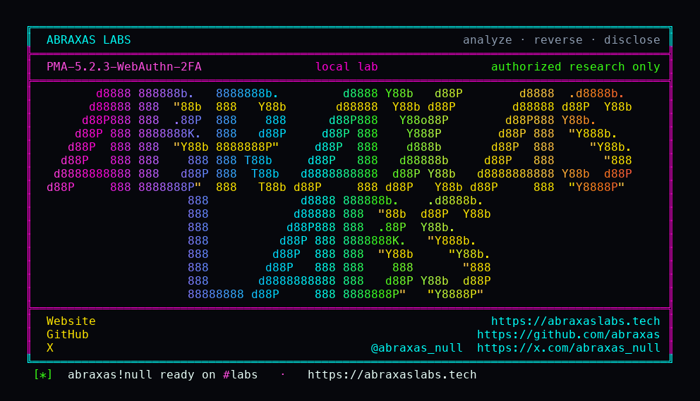

<p align="center">
  
</p>

<p align="center">
  <a href="https://abraxaslabs.tech"><strong>abraxaslabs.tech</strong></a>
  &nbsp;·&nbsp;
  <a href="https://github.com/abraxas">github.com/abraxas</a>
  &nbsp;·&nbsp;
  <a href="https://x.com/abraxas_null">@abraxas_null</a>
  &nbsp;·&nbsp;
  <a href="https://github.com/abraxas/PMA-5.2.3-WebAuthn-2FA">PMA-5.2.3-WebAuthn-2FA</a>
</p>

# PMA-5.2.3-WebAuthn-2FA

**phpMyAdmin** `5.2.3` - phpMyAdmin

Default tarball. `web-auth/webauthn-lib` is suggest / require-dev. `composer install --no-dev` does not install it. [`createServer`](https://github.com/phpmyadmin/phpmyadmin/blob/RELEASE_5_2_3/libraries/classes/Plugins/TwoFactor/WebAuthn.php) therefore uses [`CustomServer`](https://github.com/phpmyadmin/phpmyadmin/blob/RELEASE_5_2_3/libraries/classes/WebAuthn/CustomServer.php). That class parses `response.signature` (the field must exist and decode) and never COSE-verifies it. It never uses the stored `credentialPublicKey`. The product's own [`CustomServerTest`](https://github.com/phpmyadmin/phpmyadmin/blob/RELEASE_5_2_3/test/classes/WebAuthn/CustomServerTest.php) accepts an assertion with **no public key**.

**After the MySQL password, a garbage WebAuthn signature that still matches challenge, origin, rpIdHash, and user-present is a full phpMyAdmin session. That is the database.**

| | |
|---|---|
| ID | no CVE yet |
| CWE | [CWE-347](https://cwe.mitre.org/data/definitions/347.html), [CWE-287](https://cwe.mitre.org/data/definitions/287.html) |
| CVSS | **High: 8.1** `CVSS:3.1/AV:N/AC:L/PR:L/UI:N/S:U/C:H/I:H/A:N` |
| Product | [phpMyAdmin](https://www.phpmyadmin.net/) |
| Affected | **5.2.3** default tarball (`web-auth/webauthn-lib` absent) |
| Auth | MySQL password, then WebAuthn skipped |
| License | [GNU Affero GPL v3.0](LICENSE) |
| Lab | `127.0.0.1` only |

## What an attacker can do

They still need the MySQL password (cookie login). After that password, they POST `webauthn_request_response` with matching challenge, origin host, `rpIdHash`, user-present, enrolled credential id, and a garbage signature. They land in the normal UI. 2FA is gone. That is RCE on the data, not a PHP shell on the host.

If you actually installed `web-auth/webauthn-lib`, you are on `WebauthnLibServer` and not this bug.

## How I found it

I read `createServer`, then `parseAndValidateAssertionResponse`, then the unit test that does not pass a public key. Structural checks are real: credential id in `allowCredentials`, `clientData.type == webauthn.get`, challenge matches session, origin host, `rpIdHash`, user-present. Signature is parsed and ignored.

The first client I pointed at this was polite. It POSTed a WebAuthn JSON without a prior password session. Login page. It POSTed `route=/` with a signature that did not even satisfy the structural checks. You stay on 2FA. `webauthn_request_response` is still in the HTML.

Wrong turns already recorded: `Webauthn\Server` present (wrong server class); challenge not the one from this session; origin host mismatch; user-present flag clear; credential id not in `allowCredentials`; unauthenticated, no MySQL password; a reverse shell. Theatre. The tell is the 2FA field gone and a phpMyAdmin navigation page.

Client bugs look like product bugs. A helper that shadows `http.client` never sends a packet. `.recv()` on an `HTTPResponse` is not `.read()`. I mention that once because it cost time and looked, for a minute, like phpMyAdmin was fine.

Then: POST username/password/token. Pull the session challenge from the 2FA page. POST the forged assertion. `still_2fa=False` `landed=True`. Lab Dockerfile copies 5.2.3, `composer install --no-dev`, then **deletes** `vendor/web-auth` so `CustomServer` is the one in play. The last `php -r` exits 1 if `Webauthn\Server` exists. The image must fail the build if the lib is still there. `init.sql` enrolls WebAuthn 2FA for `appuser` without a hardware key.

## Lab

```bash
cd lab
./run.sh
```

Target **only** `http://127.0.0.1:18080`. Place phpMyAdmin 5.2.3 as `src/` next to the Dockerfile first.

```text
password-login status=200 webauthn=True
2fa-post status=200 still_2fa=False landed=True
SUCCESS PMA-WEBAUTHN-BYPASS WebAuthn 2FA accepted with garbage signature
```

## The fix

Install `web-auth/webauthn-lib` so `createServer` uses the lib, or actually COSE-verify `response.signature` against the stored public key in `CustomServer`. Until then, disable WebAuthn 2FA or do not expose this phpMyAdmin.

## References

- [github.com/phpmyadmin/phpmyadmin](https://github.com/phpmyadmin/phpmyadmin) tag [RELEASE_5_2_3](https://github.com/phpmyadmin/phpmyadmin/tree/RELEASE_5_2_3)
- [`CustomServer::parseAndValidateAssertionResponse`](https://github.com/phpmyadmin/phpmyadmin/blob/RELEASE_5_2_3/libraries/classes/WebAuthn/CustomServer.php) · [`WebAuthn::createServer`](https://github.com/phpmyadmin/phpmyadmin/blob/RELEASE_5_2_3/libraries/classes/Plugins/TwoFactor/WebAuthn.php) · [`CustomServerTest`](https://github.com/phpmyadmin/phpmyadmin/blob/RELEASE_5_2_3/test/classes/WebAuthn/CustomServerTest.php)
- [WebAuthn-3 verifying assertion](https://www.w3.org/TR/webauthn-3/#sctn-verifying-assertion)
- [CWE-347](https://cwe.mitre.org/data/definitions/347.html) · [CWE-287](https://cwe.mitre.org/data/definitions/287.html)

## License

GNU Affero GPL v3.0. See [LICENSE](LICENSE). Loopback lab only. No warranty.
